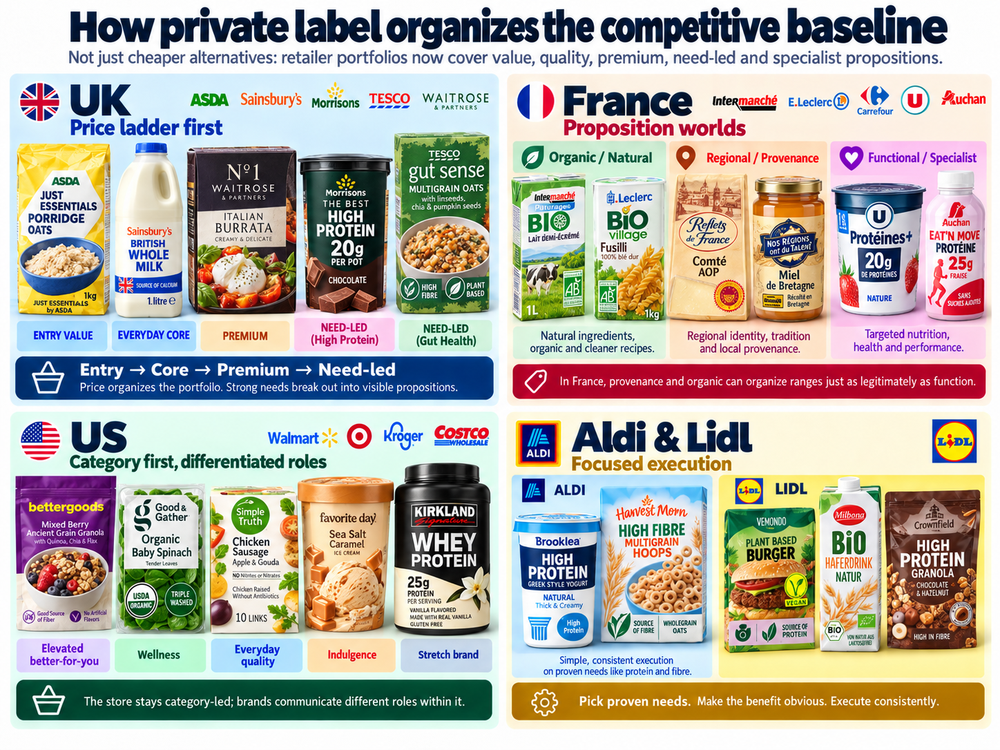
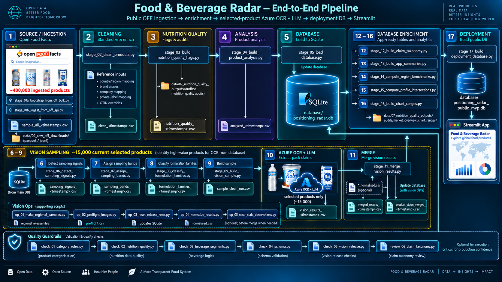

# Food & Beverage Positioning Radar

**An open-data market-intelligence project combining an interactive Streamlit
board with standalone business analyses of how packaged foods and beverages
position themselves through portfolio architecture, nutrition, ingredients,
processing, and on-pack communication.**

[](https://opendatacommons.org/licenses/odbl/)
[](https://www.apache.org/licenses/LICENSE-2.0)
[](https://www.python.org/)
[](https://world.openfoodfacts.org/)

[Explore the app](https://food-beverage-positioning-radar.streamlit.app/) ·
[Read the presentations](presentations/README.md) ·
[Review the methodology](docs/03_PROJECT_REFERENCE/02_METHODOLOGY.md)

> **The Streamlit app is in beta.** The project also delivers completed,
> publicly shared business presentations, beginning with private-label analysis.
> Open Food Facts provides the core product data, with governed analytical
> layers and supplementary retailer research for the business analyses.

## What This Is

Food & Beverage Positioning Radar turns open product data into an interactive
analytical board and reviewed business presentations. The app helps users
inspect product composition, categories, brands, company mappings and pack
communication. The presentations bring these evidence layers together to
interpret retailer portfolios and positioning patterns.

The central question is:

**How do packaged foods and beverages position themselves through claims,
ingredients, nutrition, processing, and design?**

The project does not judge products, assess legal compliance, recommend purchases,
rank brands, or estimate market share. It organizes open product data so users
can inspect patterns and make their own interpretation.

## Private-Label Analyses

Four publicly shared presentations examine private-label positioning across
**Aldi and Lidl France, UK and US; top 6 retailers in France, top 5 in UK and
top 5 in US**.

Each analysis covers three dimensions:

- **Architecture:** how brands and ranges organize the retailer's portfolio
  across value, quality, premium and specialist propositions.
- **Composition:** category-level nutrition medians compared with the observed
  regional-category market median.
- **Claims:** the incidence of detected claims and the mix of positioning
  territories, with the analyzed-pack or claim-bearing denominator stated
  in the supporting evidence.



*Visual summary of the private-label analyses, prepared separately from the
presentation PDFs. Product examples illustrate portfolio propositions.*

| Analysis | Presentation |
|---|---|
| Aldi and Lidl — France, UK and US | [Read the Aldi and Lidl analysis (PDF)](presentations/private_label_analysis/aldi_lidl/aldi_lidl_architecture.pdf) |
| Top 6 retailers in France | [Read the France analysis (PDF)](<presentations/private_label_analysis/mainstream_france_retailers/private_labels_france_top 5_retailers.pdf>) |
| Top 5 retailers in UK | [Read the UK analysis (PDF)](presentations/private_label_analysis/mainstream_uk_ie_retailers/private_labels_uk_top_5_retailers.pdf) |
| Top 5 retailers in US | [Read the US analysis (PDF)](<presentations/private_label_analysis/mainstream_us_canada_retailers/private_labels_us_top 5_retailers.pdf>) |

These standalone analyses are independent of Streamlit. Architecture was
developed with GPT-5.5 through chat, reviewed and aligned by Julia Lenc, the repo
owner, and reviewed by retail professionals. Retailer websites and packshots
supplemented Open Food Facts inputs. Aggregate CSVs support composition and
claims calculations; product-level input exports are retained locally.

The underlying data uses the project's France, UK/Ireland and US/Canada
regional groupings. The France PDF retains its historical "top 5" filename
despite the six-retailer analytical scope.

See the [private-label methodology](docs/03_PROJECT_REFERENCE/02_METHODOLOGY.md#private-label-analysis)
and [evidence guide](presentations/private_label_analysis/README.md) for
denominators, source limitations and documented PDF/evidence differences.
The original Aldi/Lidl PDF awaits revision; its reviewed evidence is not an
exact reproduction of every slide value. The evidence guide also records an
unresolved Asda discrepancy in the UK presentation.

## App Scope

The beta Streamlit app focuses on observed Open Food Facts records in:

- France
- UK & Ireland
- US & Canada

Current Streamlit categories:

- Snacks
- Cereals
- Dairy
- Beverages

Counts are observed Open Food Facts records after project cleaning rules. They
are not sales volumes, launch counts, household penetration, retail
distribution, shelf share, or consumer-demand estimates.

## What The App Shows

**Market Overview** shows high-level patterns for a selected market-category
base. It supports category reports, brand comparison, company/brand drill-down,
product-level nutrition maps, and a beverage view segment filter that separates
ready-to-drink beverages from beverage preparations / alcohol and unknown
beverage records.

**Product Explorer** lets users search individual products, filter by category,
market, brand, company, nutrition status, NOVA, Nutri-Score, and detected
positioning signals, then inspect product-level evidence.

**Methodology** and **About** explain how to read the data, what the app does
not claim, and where Open Food Facts source limitations matter.

## Governance Status

The core governance layers are documented and locked for the reviewed MVP
scope:

- category cleanup and exact product-level category corrections;
- retailer/private-label mapping, nine priority manufacturer portfolios and
  regional-category orphan-brand review;
- nutrition-quality hard gates for Product Explorer and Market Overview,
  with warnings retained separately;
- beverage view segmentation and chart-range controls for display readability.

Exact reviewed GTIN corrections take precedence over broad rules. Products
can remain under `Other / not mapped to a company` when evidence is ambiguous.
Company routing is directional analytical metadata, not legal ownership truth.

Detailed rules, review thresholds and historical results are recorded in
[category governance](docs/01_PRODUCT_DATA_GOVERNANCE/01_CATEGORY_SCOPE_AND_CLEANUP.md),
[brand/company governance](docs/01_PRODUCT_DATA_GOVERNANCE/02_BRAND_COMPANY_MAPPING.md)
and [nutrition governance](docs/01_PRODUCT_DATA_GOVERNANCE/03_NUTRITION_QUALITY_GOVERNANCE.md).

## Methodology In Brief

The app separates two evidence layers:

**Structured product evidence** comes from Open Food Facts records plus governed
project-derived metadata. It includes composition data such as nutrition values,
ingredients, Nutri-Score, and NOVA group, alongside category scope, market tags,
brand normalization, and company / owner routing.

**Pack-communication evidence** comes from Azure OCR and structured LLM
extraction on selected front-pack images. The latest approved UK profile also
uses product-name and brand text to recognize shopper-facing "free from"
branding and origin wording such as "British Milk". These contextual rules are
documented in the [extraction methodology](docs/02_PACK_IMAGE_ANALYSIS/01_FRONT_PACK_CLAIM_EXTRACTION.md);
they do not automatically detect flag images.

As checked on **16 October 2026**, the local working database contains
**23,403 vision-sourced observations**, including confirmed no-claim
observations. Targeted private-label enrichment expanded the original country
samples. This combined coverage is not representative market-level claim
prevalence and does not establish the current live-app coverage.

The qualitative GPT-5.5 architecture research used in the presentations is a
separate process from Azure pack-claim extraction. Exact architecture prompts
were not retained; the methodology explains the limits of reproduction.

Core data principles:

- raw source values are preserved where the pipeline has provenance fields;
- missing values are not treated as zero;
- category, brand, company, and nutrition fields are governed derived layers;
- Product Explorer can show imperfect but useful records;
- all products that pass Product Explorer hard validity gates are used in
  Market Overview calculations;
- Market Overview charts use the same valid population, with precomputed
  chart-range controls for visualization readability;
- exact reviewed GTIN overrides outrank broad brand/company/category rules.

## Known Limitations

- Open Food Facts is crowdsourced; records can be incomplete, duplicated,
  outdated, or inconsistent.
- Product counts are observed records, not market size.
- Country tags indicate where a product was observed in Open Food Facts, not
  guaranteed distribution.
- Brand/company ownership can be market-specific, product-form-specific,
  license-specific, or recently changed.
- Company filters are directional navigation aids, not legal ownership
  guarantees.
- Some products remain under `Other / not mapped to a company` after review.
- Beverage segmentation is rule-based and not a complete commercial beverage
  taxonomy.
- Front-pack claim extraction covers selected image-analyzed products only;
  targeted retailer enrichment and differing prompt rules affect comparability.
- Presentation architecture is qualitative and reviewed; category medians can
  reflect assortment mix, and small retailer samples limit generalization.
- Cold starts and broad filter changes can be slower on the public beta
  deployment.

## How To Run

```bash
git clone https://github.com/julialenc/food-beverage-positioning-radar.git
cd food-beverage-positioning-radar
python -m venv .venv
.venv\Scripts\activate
pip install -r requirements.txt
streamlit run app.py
```

Azure Vision and Azure OpenAI credentials are required only for the vision
pipeline. The Streamlit app can run from the prepared local database or from the
compressed public MVP database artifact included for deployment.

## Repository Layout

```
app.py                  Streamlit entry point
pages/                  Streamlit pages
shared/                 Shared UI, labels, beverage segments, and DB helpers
pipeline/               Production stages, validation checks, governance tools, prompts, and exports
data/                   Committed reference inputs plus ignored generated output homes
database/               Schema reference, local build DB, and compressed public MVP DB artifact
docs/                   Product governance, pack-image analysis, and project reference documents
presentations/          Standalone business analyses, presentation PDFs, and supporting evidence
```

Generated local workspaces are kept as empty committed folders with `.gitkeep`
placeholders:

```
data/02_raw_off_downloads/            Cached OFF/API inputs when regenerated
data/03_pipeline_intermediates/       Core OFF pipeline CSV outputs
data/04_vision_sampling/              Pre-extraction sampling outputs
data/05_vision_release/               Vision release samples, results, merge files, and QA outputs
data/06_brand_governance_outputs/     Category and brand/company governance review exports
data/07_nutrition_quality_outputs/    Nutrition-quality audit and review outputs
```

The publication set includes the presentation PDFs, selected aggregate CSV
evidence, documented review decisions and guides under `presentations/`,
alongside production reference inputs and the compressed app database.
An explicit allowlist controls the private-label evidence files.

Raw Open Food Facts downloads, pipeline intermediates, product-level analysis
inputs, local audit exports and the full working SQLite database remain local.
Historical pipeline experiments and superseded prompts are retained in the
ignored `pipeline/local_only/` archive.

Frozen presentation inputs must not be overwritten by fresh exports. A new OFF
download or database run can differ from historical evidence, and a public
checkout lacks the local inputs needed to reproduce every analysis.
See the [evidence guide](presentations/private_label_analysis/README.md) and
[pipeline retention audit](pipeline/PIPELINE_RETENTION_AUDIT.md).

## Production Reference Files

The production reference layer is under `data/01_reference_inputs/`:

- `01_country_region_mapping.csv` - OFF country to project region-code mapping;
- `02_brand_alias_mapping.csv` - reviewed brand-string aliases;
- `03_company_brand_mapping.csv` - reusable brand-to-company routing rules;
- `04_private_label_brand_mapping.csv` - reviewed retailer/private-label brand
  architecture;
- `05_reviewed_product_mapping_overrides.csv` - exact GTIN-level reviewed brand,
  company, category, and `OUT_OF_SCOPE` overrides;
- `06_top_company_brand_portfolio_matrix.csv` - priority manufacturer portfolio and
  discovery reference;
- `README.md` - reference-file descriptions and provenance notes.

These files are project-maintained derived inputs used by the cleaning and
governance layers. Their resolved outputs are subsequently loaded into SQLite
and consumed by the Streamlit app.

## Pipeline Overview



*End-to-end architecture: modular data processing, selected-product OCR/LLM enrichment, and independent quality guardrails.*

The standard local build path is:

```
01A. pipeline/stages/stage_01a_bootstrap_from_off_bulk.py
     or
01B. pipeline/stages/stage_01b_ingest_from_off_api.py
02.  pipeline/stages/stage_02_clean_products.py
03.  pipeline/stages/stage_03_build_nutrition_quality_flags.py
04.  pipeline/stages/stage_04_build_product_analysis.py
05.  pipeline/stages/stage_05_load_database.py
06.  pipeline/stages/stage_06_detect_sampling_signals.py
07.  pipeline/stages/stage_07_assign_sampling_bands.py
08.  pipeline/stages/stage_08_classify_formulation_families.py
09.  pipeline/stages/stage_09_build_vision_sample.py
10.  pipeline/stages/stage_10_extract_pack_claims.py  [paid/manual vision stage]
11.  pipeline/stages/stage_11_merge_vision_results.py
12.  pipeline/stages/stage_12_build_claim_taxonomy.py
13.  pipeline/stages/stage_13_build_app_summaries.py
14.  pipeline/stages/stage_14_compute_region_benchmarks.py
15.  pipeline/stages/stage_15_compute_profile_intersections.py
16.  pipeline/stages/stage_16_build_chart_ranges.py
17.  pipeline/stages/stage_17_build_deployment_database.py
```

The ordered stages build the app dataset. Separate maintenance, governance and
analysis tools support mapping reviews, targeted retailer extraction and
standalone presentation evidence. Run them deliberately when refreshing the
relevant inputs. Stages 06-10 form the vision sampling/extraction branch and
are run when that branch is intentionally refreshed. Stage 10 is the paid Azure OCR + LLM step.

Vision Ops can also prepare regional release files, preflight image URLs, and
reset selected database rows before extraction.
After extraction, release files may be normalized or retired with
`pipeline/vision_ops/op_04_normalize_results.py` and
`pipeline/vision_ops/op_05_clear_stale_observations.py` before Stage 11 merges
the current release into the database.

Independent validation checks sit alongside the pipeline as quality guardrails:
they are not data dependencies, but they are important for production
confidence.

Navigation files:

- [Pipeline navigation](pipeline/README_NAVIGATING_PIPELINE.md) — stages,
  supporting analysis tools and local archive locations.
- [Pipeline retention audit](pipeline/PIPELINE_RETENTION_AUDIT.md) — dependency
  review and public/local retention decisions.
- [Data navigation](data/README_NAVIGATING_DATA.md) — data-folder tree and
  generated-output contract.

## Documentation

- [Presentations and business analyses](presentations/README.md) — PDFs and
  analysis navigation.
- [Private-label evidence](presentations/private_label_analysis/README.md) —
  composition benchmarks, claims denominators and review status.
- [Methodology](docs/03_PROJECT_REFERENCE/02_METHODOLOGY.md) — evidence layers,
  metric definitions and interpretation rules.
- [Limitations](docs/03_PROJECT_REFERENCE/03_LIMITATIONS.md) — source quality,
  coverage and reproduction limits.
- [Category governance](docs/01_PRODUCT_DATA_GOVERNANCE/01_CATEGORY_SCOPE_AND_CLEANUP.md) —
  category scope and reviewed corrections.
- [Brand/company governance](docs/01_PRODUCT_DATA_GOVERNANCE/02_BRAND_COMPANY_MAPPING.md) —
  normalization, ownership routing and exact overrides.
- [Nutrition governance](docs/01_PRODUCT_DATA_GOVERNANCE/03_NUTRITION_QUALITY_GOVERNANCE.md) —
  hard gates, warnings and chart treatment.
- [Data dictionary](docs/03_PROJECT_REFERENCE/04_DATA_DICTIONARY.md) — working
  and deployment schemas, reporting tables and presentation CSV fields.
- [Front-pack extraction](docs/02_PACK_IMAGE_ANALYSIS/01_FRONT_PACK_CLAIM_EXTRACTION.md) —
  sampling, prompts, UK rescue rules and release history.
- [Claim labels](docs/02_PACK_IMAGE_ANALYSIS/02_CLAIM_TAXONOMY_LABELS.md) —
  canonical display labels read by the app.
- [Architecture decisions](docs/03_PROJECT_REFERENCE/01_ADR.md) and
  [observations](docs/03_PROJECT_REFERENCE/05_OBSERVATIONS.md) — decisions and
  analytical review records.
- [Reference inputs](data/01_reference_inputs/README.md) — mapping files
  and provenance.

## Data Source, License, And Attribution

Product data is sourced from [Open Food Facts](https://world.openfoodfacts.org/),
licensed under the **Open Database License (ODbL)**.

Repository code and original project documentation are licensed under the
**Apache License, Version 2.0**. See [LICENSE](LICENSE) and [NOTICE](NOTICE).

If you reuse or redistribute this project, retain the Apache 2.0 license and
notice files and credit:

```
Food & Beverage Positioning Radar by Julia Lenc
```

Data attribution:

```
Data from Open Food Facts - https://world.openfoodfacts.org
```

See [CITATION.md](CITATION.md) for project and presentation citation guidance.

---

*Data from Open Food Facts - openfoodfacts.org - ODbL license*  
*Project code and documentation licensed under Apache 2.0*
